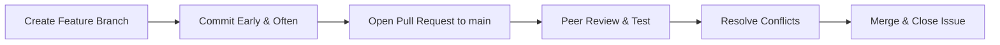

# FloraGuide (COMP90018 2026 SM2, T01/03-03)

FloraGuide is an Android app for identifying campus plants. It identifies a plant from a photo with Pl@ntNet, then adds context from nearby Atlas of Living Australia (ALA) records, the flowering season and the phone's sensors.

## Running the app

### Requirements

- **Android Studio** (current stable) with **Android SDK Platform 36**. The app runs on Android 8.0 (API 26) or newer.
- **A Gradle JDK of version 17 or 21.** The build uses Gradle 8.13, which does not run on Java 24 or newer.
- **A physical Android phone** is recommended. The camera, motion, light and compass sensors and GPS are central to the app, and an emulator only imitates them.
- **Optional API keys for the live features:** a Pl@ntNet key (free, 500 identifications a day, from [my.plantnet.org](https://my.plantnet.org)) and a Google Maps key. The guided demo works without either.

### 1. Get the code and open it

```bash
git clone https://github.com/euchoons/COMP90018_2026_SM2.git
```

In Android Studio, choose **File → Open**, select the cloned folder and let Gradle sync finish.

If sync fails with an error that names a newer Java version (for example "What went wrong: 25.0.4"), go to **Settings → Build, Execution, Deployment → Build Tools → Gradle → Gradle JDK** and choose a JDK 17 or 21. The drop-down can download one.

### 2. Add your API keys (optional)

Android Studio creates `local.properties` in the project root. Git ignores it, so keys added there stay on your computer. Add:

```properties
plantnet.api.key=YOUR_PLANTNET_KEY
MAPS_API_KEY=YOUR_GOOGLE_MAPS_KEY
```

Rebuild after changing them. Never commit keys.
- **Without a Pl@ntNet key,** live identification reports the missing key.
- **Without a Maps key,** the Field Guide shows a "Map unavailable" placeholder.

The Firebase configuration (`app/google-services.json`) is already in the repository, so no extra setup is needed for sign-in, uploads or sync.

### 3. Run it

- **On a phone:**
  1. In **Settings → About phone**, tap **Build number** seven times, then turn on **Developer options → USB debugging**.
  2. Connect the phone, select it in Android Studio's device menu, and press **Run** with the `app` configuration selected.
- **On an emulator:** create one in **Device Manager** (API 26 or newer; use a Google APIs image so the map works), then press **Run**. The emulator's camera shows a virtual room and its sensors don't move, so the stability gate and compass can't be judged there.
- **From a terminal,** with a phone or emulator connected:
  - Git Bash or macOS/Linux: `./gradlew installDebug`
  - PowerShell or Command Prompt: `.\gradlew.bat installDebug`

### 4. Try it

- **Guided demo** (no keys or network needed): on the sign-in screen, choose **Continue Offline (Demo)** if you aren't signing in. Then tap **Demo** on Home, or **Run explicit offline guided demo** on Observe. It uses a fixed date, a campus location and sample species, so it shows the whole flow without live requests.
- **Live observation:**
  1. Sign in, or choose **Continue as Guest (Internet Required)**.
  2. Open **Observe** and allow camera and location access. Wait for "Device location ready"; outdoors this takes a few seconds.
  3. Hold the phone still until the shutter enables, then take a photo.
  4. Agree to online identification. The photo is uploaded, identified by Pl@ntNet, and ranked with nearby ALA records.
  5. Pick a candidate and save it. It then appears in the **Field Guide** and on its map.

### Build and test from a terminal

```bash
./tools/check.sh              # unit tests, lint and a debug build (needs a POSIX shell such as Git Bash)
./gradlew testDebugUnitTest   # unit tests only
./gradlew assembleDebug       # APK at app/build/outputs/apk/debug/app-debug.apk
```

In a terminal, Gradle uses the JDK in `JAVA_HOME`. Point that, or `org.gradle.java.home` in `~/.gradle/gradle.properties`, at a JDK 17 or 21. Use the JetBrains Runtime that Android Studio downloads, or Temurin: on Oracle's JDK, the Robolectric unit tests fail at setup with "Framework jar verification can not be initialized".

### Troubleshooting

| Problem | Fix |
| --- | --- |
| Gradle sync or build fails naming Java 24 or 25 | Set the Gradle JDK to 17 or 21 (see step 1) |
| Live identification says the Pl@ntNet key is missing | Add `plantnet.api.key` to `local.properties` and rebuild |
| The Field Guide map says "Map unavailable" | Add `MAPS_API_KEY` to `local.properties` and rebuild |
| Location stays on "Waiting…" | Go outdoors or near a window. With approximate location only, the first fix can take up to about 10 minutes |

More detail is in the [quick start](docs/FLORAGUIDE.md).

## Project documentation

Start with the [documentation index](docs/README.md) for setup, current status, technical references, testing and assignment records.

---

## Team workflow rules

> 📝 **Please Read:** All team members must strictly follow the development workflows, documentation regulations, and naming conventions outlined below.

## 🛠 Workload Documentation & Issue Tracking

* **Issue Mapping:** Map every single project requirement to a dedicated **GitHub Issue**.
* **Task Assignment:** Always assign yourself to an Issue **before** you start working on it. Never write code for unassigned tasks.
* **Project Boards:** Track progress using a **GitHub Project Board** (Kanban style) featuring four mandatory columns:
  * `To Do`
  * `In Progress`
  * `Review`
  * `Done`
* **Commit Frequency:** Commit code **early and often**. 
  * ⚠️ *Warning:* Large, single-day code dumps at the end of the semester look suspicious to automated plagiarism tools and contribution trackers. Keep your git history incremental and organic!

---

## 🌿 Branching & Naming Conventions

> 🚨 **CRITICAL RULE:** NEVER CODE DIRECTLY ON THE `main` BRANCH!! Always implement a feature-branch workflow.

### Branch Naming Nomenclature
Use lowercase letters, hyphens to separate words, and ensure your branch includes a valid category prefix as shown in the table below:

| Category Prefix | Purpose | Examples |
| :--- | :--- | :--- |
| **`feature/`** | For developing new features | `feature/user-login`, `feature/database-setup` |
| **`fix/`** | For resolving bug fixes | `fix/auth-error`, `fix/broken-css` |
| **`refactor/`** | For code optimization without altering functionality | `refactor/api-calls` |

---

## 🔄 Pull Request (PR) & Code Review Workflow



1. **Create a PR:** When a feature or fix is completed, open a Pull Request from your branch targeting the `main` branch.
2. **Link Issues:** Include text like `Closes #IssueNumber` inside your PR description. This automatically links and closes the corresponding issue when merged.
3. **Peer Review:** At least **one other teammate** must thoroughly review the code, test it locally if necessary, and explicitly click **"Approve"**.
4. **Conflict Resolution:** The PR author bears the sole responsibility for tracking and resolving any merge conflicts prior to final merging.
5. **The 24-Hour Rule:** Give teammates at least **24 hours** to review a PR before bumping them or sending follow-up alerts on team chat.

---

## 👥 Team Members
* 👤 **Tom**
* 👤 **Mason**
* 👤 **Mingyang**
* 👤 **Seb**
* 👤 **Asleif**
